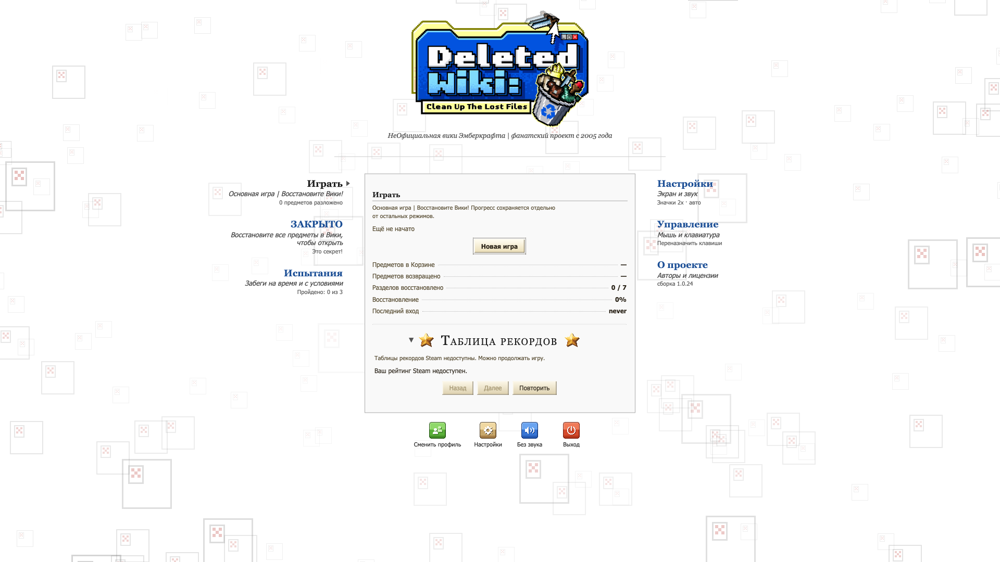
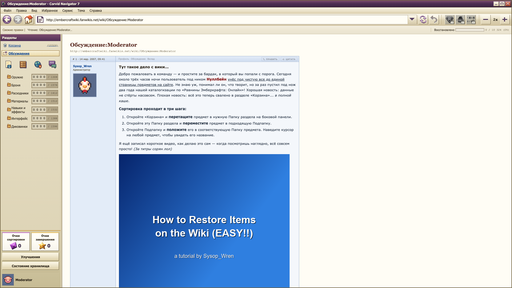

# Deleted Wiki: Clean Up the Lost Files · Русификатор

Полный русский перевод и мод-меню «Консоль сисопа Corvid» для **Deleted Wiki: Clean Up the Lost Files** (Steam `1.0.24`, сборка `26304123`, Windows, Steam Deck и macOS).

## Скачать
- **[Сборка 2-в-1 (русификатор + мод-меню) и обновления на Boosty](https://boosty.to/cd_tixo/posts/7446d8dd-7024-4e12-9a7e-9e93afa01ec7?utm_source=github&utm_medium=readme&utm_campaign=deleted_wiki):** единый установщик с выбором нужных модулей галочками и обновлениями под патчи.
- **[Базовый русификатор v1.0 на GitHub Releases](https://github.com/neoru-droid/deleted-wiki-ru/releases/tag/v1.0.0):** перевод текста, шрифта и экрана достижений · [Как установить](#установка) · [Руководство в Steam](https://steamcommunity.com/sharedfiles/filedetails/?id=3842897222)

Проверено на версии `1.0.24` (сборка Steam `26304123`) для **Windows**, **Steam Deck / Linux** и **macOS**.

## Установка
1. **Windows:** закройте игру, распакуйте архив и запустите `DeletedWiki-RU-Setup.exe` -> **«Установить русификатор»** (или `DeletedWiki-Full-Setup.exe` в полной сборке «2-в-1» с Boosty).
2. **Steam Deck / Linux:** распакуйте все файлы архива в одну папку и выполните `sh install-steamdeck.sh`.
3. **macOS:** распакуйте файлы архива в одну папку и запустите `install-macos.command` в Finder.
4. Кнопка **«Вернуть оригинал»** убирает перевод через тот же установщик. В издании «2-в-1» модули можно ставить и удалять раздельно в любом порядке.

*(Окно SmartScreen на Windows: «Подробнее» -> «Выполнить в любом случае».)*

## Что входит в перевод
- Полный каталог фанатской вики EmberCraft: 631 предмет в 7 разделах и 25 полках со всеми состояниями и пометками копий.
- Весь интерфейс портала, 15 скриптов автоматизации, забеги на время и экран 29 достижений внутри раздела «Состояние хранилища».
- Переписка администраторов 2007 года, ветки форума, архив Нуллбейна, книга памяти, финал и 250 реплик помощника вИИрона.
- Адаптированный кириллический шрифт Underdog (`SIL OFL 1.1`) без обрезки подписей, правильные русские склонения счётчиков и поиск предметов без различения букв «е» и «ё».

## Скриншоты

Открыть игровые кадры

**Главный портал вики**

**Корзина неразобранных файлов**

**Скрипты модератора**

**Форум, письма и сюжетные записи**

**Состояние хранилища и экран 29 достижений**

## История обновлений
- **[v1.0](https://github.com/neoru-droid/deleted-wiki-ru/releases/tag/v1.0.0)** - первый выпуск перевода (3 039 строк, шрифт Underdog с кириллицей, поиск с поддержкой «е/ё» и экран 29 достижений в игре) под патч 1.0.24 (сборка 26304123).

## Обратная связь и проекты автора

Перевод сделан нейросетью и проверен в игре. Найдёте опечатку или косяк - пишите в [Issues](https://github.com/neoru-droid/deleted-wiki-ru/issues), поправлю.

Предложить игру на перевод в приоритетную очередь или заказать разбор вне очереди можно на [странице Boosty](https://boosty.to/cd_tixo?utm_source=github&utm_medium=readme&utm_campaign=order_game).

Все проекты автора: [сайт каталога](https://neoru-droid.github.io/) · [каталог на Boosty](https://boosty.to/cd_tixo/posts/2a55d7e9-0f53-4d93-9f66-280981158dec?utm_source=github&utm_medium=readme&utm_campaign=deleted_wiki) · [профиль на GitHub](https://github.com/neoru-droid)

Лицензия: [MIT](LICENSE) (шрифт Underdog в `fonts/` распространяется под SIL OFL 1.1)

Автор: `neoru-droid`
