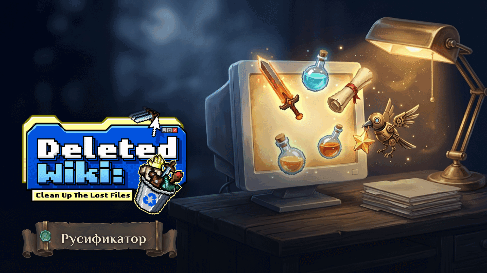
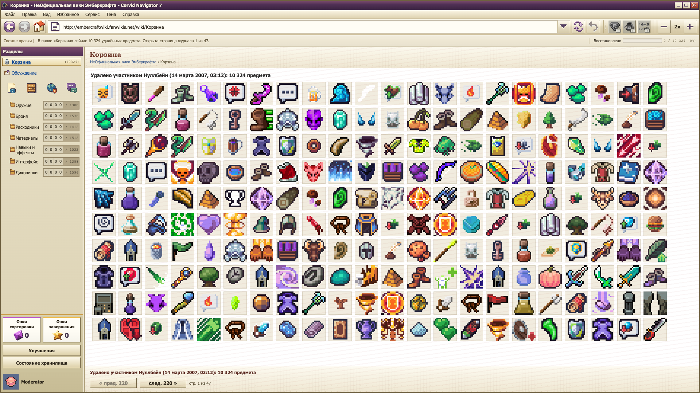
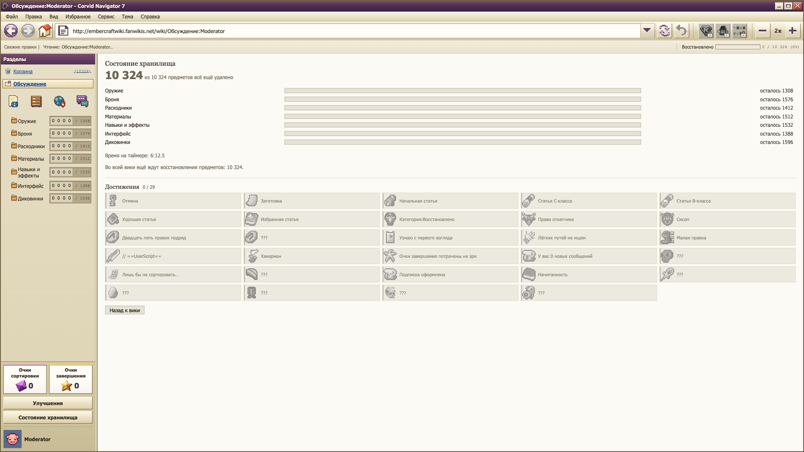

# Deleted Wiki: Clean Up the Lost Files · Русификатор

Каталог из 631 предмета, 15 скриптов, форум, письма, реплики вИИрона, адаптированный кириллический шрифт `Underdog` и экран 29 достижений на русском языке.

- **[Скачать перевод v1.0 (ZIP)](https://github.com/neoru-droid/deleted-wiki-ru/releases/download/v1.0.0/DeletedWiki-RU-v1.0.zip)** · [Как установить](#установка)
- **[Единая страница релиза с мод-меню на Boosty (бесплатно, без регистрации)](https://boosty.to/cd_tixo/posts/7446d8dd-7024-4e12-9a7e-9e93afa01ec7)**

Проверено на версии 1.0.24 (сборка Steam 26304123) для **Windows**, **Steam Deck / Linux** и **macOS**. Достижения Steam продолжают открываться как обычно, а кнопка удаления в любой момент возвращает чистую оригинальную игру.

## Установка
1. **Windows:** закройте игру, распакуйте архив и запустите `DeletedWiki-RU-Setup.exe` -> **«Установить русификатор»**.
2. **Steam Deck / Linux:** распакуйте все файлы архива в одну папку и выполните `sh install-steamdeck.sh` рядом с `DeletedWiki-RU-Setup.exe`.
3. **macOS:** распакуйте файлы архива в одну папку и запустите `install-macos.command` в Finder.
4. Кнопка **«Вернуть оригинал»** полностью удаляет перевод в один клик. Перевод совместим с [внутриигровым мод-меню](https://github.com/neoru-droid/deleted-wiki-trainer-ru) (оба модуля ставятся и удаляются независимо в любом порядке).

*(Окно SmartScreen на Windows: «Подробнее» -> «Выполнить в любом случае».)*

## Что входит в перевод
- Полный каталог фанатской вики EmberCraft: 631 предмет в 7 разделах и 25 полках с аккуратным согласованием состояний копий и модификаторов.
- Весь интерфейс портала, 15 скриптов автоматизации, забеги на время и экран 29 достижений внутри раздела «Состояние хранилища».
- Переписка администраторов 2007 года, ветки форума, архив Нуллбейна, книга памяти, финал и 250 реплик помощника вИИрона.
- Адаптированный кириллический шрифт Underdog (`SIL OFL 1.1`) без обрезки подписей, правильные русские склонения счётчиков и поиск предметов без различения букв «е» и «ё».

## Скриншоты

Открыть игровые кадры

**Главный портал вики**

**Корзина неразобранных файлов**

**Скрипты модератора**

**Форум, письма и сюжетные записи**

**Состояние хранилища и экран 29 достижений**

## История обновлений
- **[v1.0](https://github.com/neoru-droid/deleted-wiki-ru/releases/tag/v1.0.0)** - первый полный релиз перевода (3 039 строк, шрифт Underdog с кириллицей, поиск с поддержкой «е/ё» и экран 29 достижений в игре) под патч 1.0.24 (сборка 26304123).

[Все версии](https://github.com/neoru-droid/deleted-wiki-ru/releases) · [Руководство в Steam](https://steamcommunity.com/sharedfiles/filedetails/?id=3842897222) · [Обсудить перевод в Steam](https://steamcommunity.com/app/5204830/discussions/0/568177480254562784/) · [Парное мод-меню](https://github.com/neoru-droid/deleted-wiki-trainer-ru)

## Поддержать
- **[Каталог релизов на Boosty](https://boosty.to/cd_tixo/posts/2a55d7e9-0f53-4d93-9f66-280981158dec)** (все бесплатные выпуски и обновления)
- **[Разовые чаевые через CloudTips (СБП / карта)](https://pay.cloudtips.ru/p/240b8760)**

Перевод сделан с помощью нейросети и проверен в игре. Найдёте опечатку или косяк - пишите в [Issues](https://github.com/neoru-droid/deleted-wiki-ru/issues), поправлю.

## Другие переводы
- [Playrooms](https://github.com/neoru-droid/playrooms-ru)
- [Frontier Tale](https://github.com/neoru-droid/frontier-tale-ru)
- [We March as One](https://github.com/neoru-droid/we-march-as-one-ru)
- [Zombies Aren't Real](https://github.com/neoru-droid/zombies-arent-real-ru)

Лицензия: [MIT](LICENSE) (шрифт Underdog в `fonts/` распространяется под SIL OFL 1.1)
